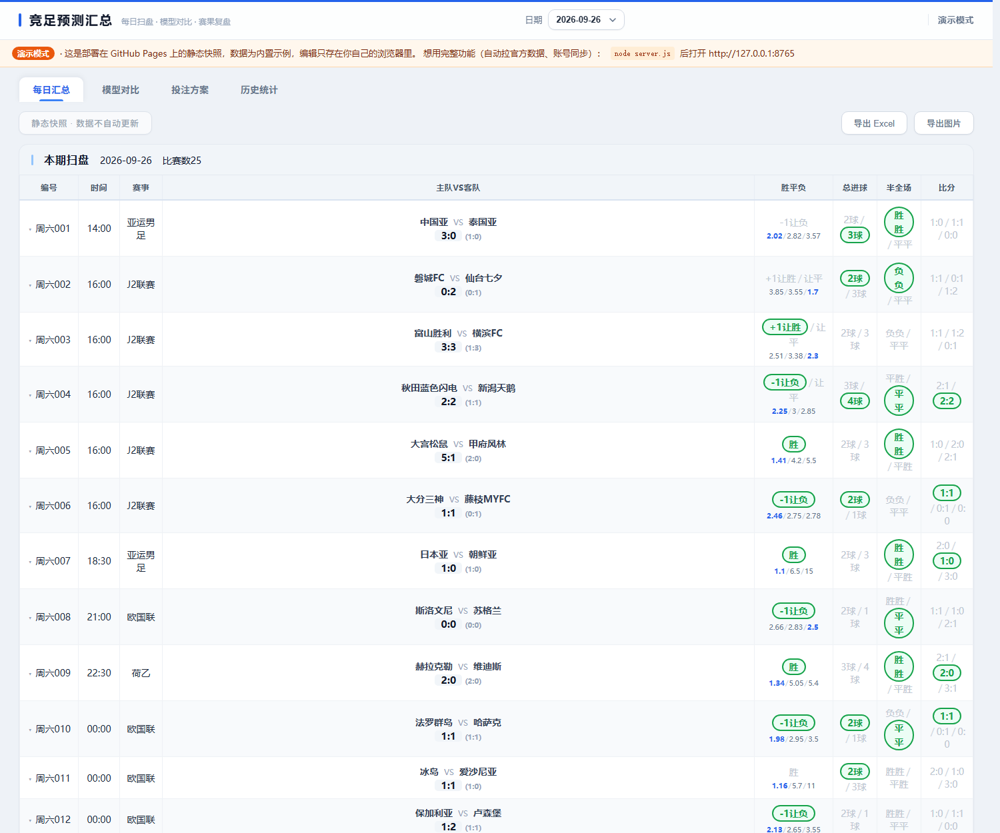
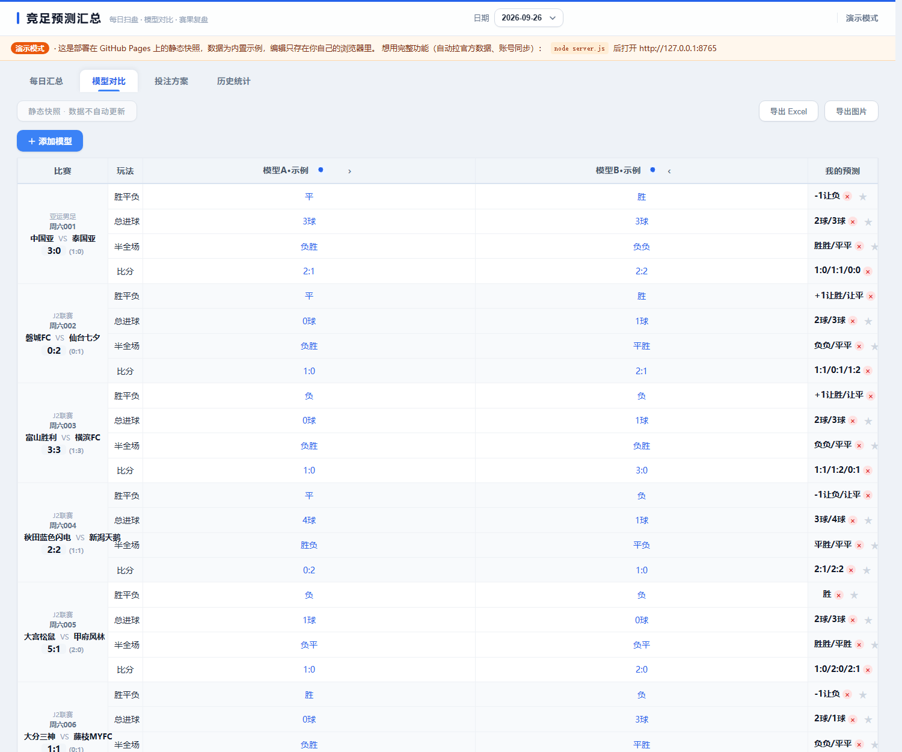
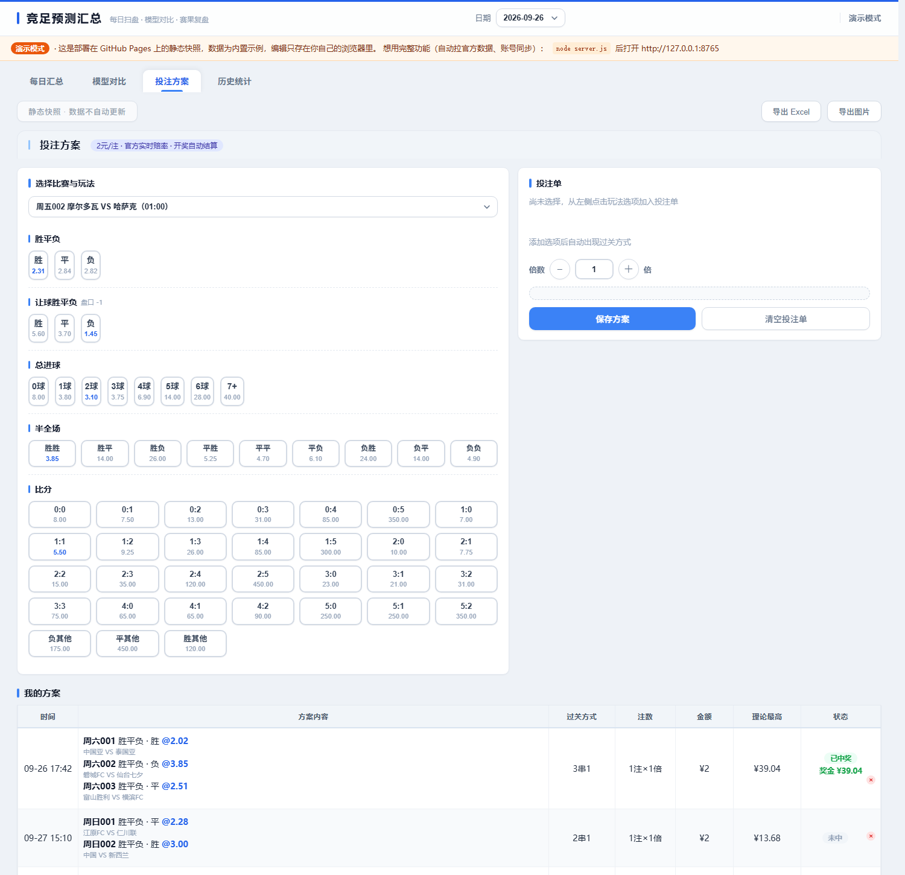
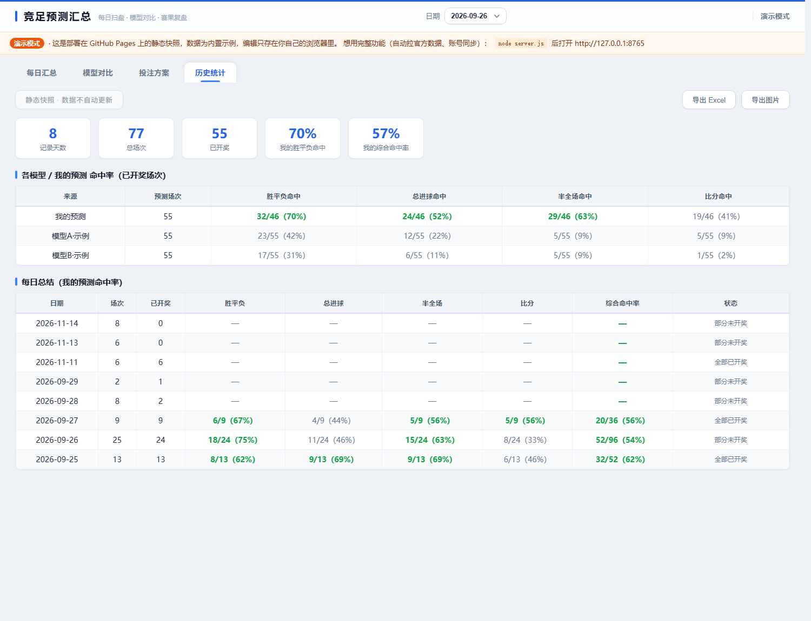

# 竞足预测汇总 · Jczq Predict

> 一个跑在自己电脑上的竞彩足球面板。自动抓官方赛程与赛果，把你信任的几个预测源录进去，横向对比分歧、算一致度、生成投注方案、沉淀历史命中率。

<p>
  <a href="https://aq18270592902-cloud.github.io/jczq-predict/"></a>
  <a href="https://github.com/aq18270592902-cloud/jczq-predict/actions/workflows/ci.yml"></a>
  
  
  
  
</p>

**在线演示**：https://aq18270592902-cloud.github.io/jczq-predict/

> 演示站是静态快照（浏览器里跑，数据只读），用来先看界面长什么样。
> 自动拉数据、账号同步、导出这些要本地 `node server.js` 才有。

## 快捷入口

| 想看什么 | 直接点 |
|---|---|
| 每日汇总（赛程 + 赔率 + 我的预测） | [在线看](https://aq18270592902-cloud.github.io/jczq-predict/?demo=1&tab=summary) |
| 模型对比（多源预测并排 + 分歧标色） | [在线看](https://aq18270592902-cloud.github.io/jczq-predict/?demo=1&tab=compare) |
| 投注方案（选场 → 过关 → 结算记录） | [在线看](https://aq18270592902-cloud.github.io/jczq-predict/?demo=1&tab=bets) |
| 历史统计（命中率 + 每日复盘） | [在线看](https://aq18270592902-cloud.github.io/jczq-predict/?demo=1&tab=stats) |

## 界面

**每日汇总** —— 赛程、让球、赔率、赛果一屏看完，每个玩法后面跟「我的预测」，命中自动描绿。



**模型对比** —— 你录入的每个预测源一列，分歧场次一眼能看出，右侧是最终决策。



**投注方案** —— 左边点玩法加进投注单，右边自动算过关方式与理论奖金，存下来的方案自动结算。



**历史统计** —— 记录天数 / 总场次 / 已开奖 / 命中率四张卡，下面是每个来源的准确率和每日复盘。



---

## 它解决什么问题

竞彩最麻烦的不是选哪场，是**几个预测源互相打架时你怎么信**。

这个面板把「官方数据 + 你的判断 + 多个模型的预测」放进同一张表：

| 层 | 内容 |
|---|---|
| 官方层 | 赛程、让球、赛果，自动拉取，可手动触发刷新 |
| 模型层 | 你自己录入的多家预测（胜平负 / 比分 / 半全场），来源自由命名 |
| 对比层 | 自动标出**分歧场次**、计算**一致度**、高亮**冷门预警** |
| 决策层 | 按一致度与赔率生成投注方案，记录实际下注与盈亏 |
| 复盘层 | 历史命中率、各模型准确率排行、赛后自动回填比分 |

所有数据存在本机 `users/<手机号>.json`，不上传、不同步。

## 快速开始

```bash
node server.js
# 打开 http://127.0.0.1:8765
```

Windows 双击 `启动网页服务.vbs` 静默启动（无黑窗）。开机自启：把该 vbs 的快捷方式丢进 `shell:startup`。

首次启动 8 秒后自动拉一次数据，之后每 2 小时一次。

## 目录结构

```
jczq-predict/
├─ server.js          # HTTP 服务：静态托管 + 账号 + 用户数据 API + 定时更新
├─ fetch_official.js  # 抓取脚本：澳客竞彩 + 500 网，写入 data.js
├─ index.html         # 单页前端
├─ app.js             # 前端逻辑（4 个 tab + 表格渲染 + 导出 + 演示模式）
├─ style.css          # 样式
├─ data.js            # 赛事数据（fetch_official.js 自动生成/覆盖）
├─ docs/screenshots/  # README 用的界面截图
├─ users/             # 用户数据，含密码哈希，已 gitignore
├─ 启动网页服务.vbs
└─ 拉取官方数据.bat
```

> 早期的 `keys.json`（卡密文件）已删除，账号体系改成手机号 + 密码，密码用 `scrypt` 加盐存 `users/`。

## 数据来源

| 来源 | 用途 | 地址 |
|---|---|---|
| 澳客竞彩在售页 | 当天/次日场次、编号、赔率 | `https://www.okooo.com/jingcai/` |
| 澳客赛果大厅 | 已完场比分 | `https://www.okooo.com/jingcai/kaijiang/` |
| 500 网 | 备用场次校验 | `https://trade.500.com/jczq/` |

页面是 GBK 编码，抓下来要 `new TextDecoder('gbk')` 解。fetch 失败会自动回落 `curl.exe`（Windows 自带）。

手动拉一次：

```bash
node fetch_official.js
node fetch_official.js --migrate 张三     # 先把现有 final 迁移成 preds["张三"]
node fetch_official.js 2026-11-12        # 指定日期
```

> 赛果次日才齐，建议每天上午拉一次。

## 演示模式怎么工作的

判断条件写在 `index.html` 里：

```js
if (/(^|\.)github\.io$/.test(location.hostname) || /[?&]demo=1/.test(location.search))
  window.STATIC_DEMO = true;
```

命中后 `app.js` 的行为：

| 位置 | 正常模式 | 演示模式 |
|---|---|---|
| `bootApp()` | 先 `fetch('/api/me')`，未登录弹登录遮罩 | 直接进主界面，顶栏写「演示模式」，隐藏退出按钮 |
| `loadJSON / persistUser` | 读写 `/api/data` | 读写 `localStorage`，不碰后端 |
| 数据轮询 | 每 2 小时 `autoCheck` | 不轮询，更新按钮置灰 |
| 模型列 | 你录入的才有 | 注入 `模型A·示例` / `模型B·示例` 两列 |
| 投注记录 | 你自己的 | 注入三条示例方案（已中奖 / 未中 / 待开奖各一条） |

示例预测是按 `FNV-1a(日期|比赛编号|盐)` 算出来的确定性伪随机，同一场比赛每次刷新结果完全一致，不会「刷一下变一次」。

想本地验证演示效果，不用推到线上：

```bash
node server.js
# 打开 http://127.0.0.1:8765/?demo=1
```

## API

| 方法 | 路径 | 说明 |
|---|---|---|
| GET | `/api/status` | 更新状态：`updating` / `lastAt` / `lastOk` / `ageMin` |
| POST | `/api/update` | 触发拉取。**需带 `X-Admin-Token`**（见下） |
| POST | `/api/register` | `{phone, password}` → 建用户 + 设 `sid` cookie |
| POST | `/api/login` | `{phone, password}` → 设 `sid` cookie |
| POST | `/api/logout` | 清 session |
| GET | `/api/me` | 当前登录手机号 |
| GET | `/api/data` | 读当前用户全部数据 |
| POST | `/api/data` | `{key, value}` 写单个字段 |

可写字段白名单：`myFinal` `customModels` `preds` `renames` `order` `bets` `notes` `tags`。

### 管理 Token

`/api/update` 以前是裸奔的（任何访问者都能触发抓取）。现在的规则：

| 调用来源 | 未设 `ADMIN_TOKEN` | 已设 `ADMIN_TOKEN` |
|---|---|---|
| 本机回环 `127.0.0.1` | 放行 | 放行（页面上的「↻ 更新比赛数据」按钮走这条） |
| 外部来源 | 403 | 必须带 `X-Admin-Token` 且匹配 |

```bash
# 启动时指定
set ADMIN_TOKEN=你的随机串
node server.js

# 或者写进 .env（已 gitignore）
ADMIN_TOKEN=你的随机串
```

```bash
curl -X POST -H "X-Admin-Token: 你的随机串" http://127.0.0.1:8765/api/update
```

## 监听地址

默认 `127.0.0.1`，只本机可访问。要局域网访问：

```bash
set HOST=0.0.0.0
node server.js
```

此时**务必**同时设 `ADMIN_TOKEN`。

## 用户数据

`users/{手机号}.json`：

```json
{
  "phone": "13800138000",
  "salt": "16字节hex",
  "passHash": "scrypt-64字节hex",
  "createdAt": "2026-11-12T09:00:00.000Z",
  "data": { "myFinal": {}, "preds": {}, "bets": [], "notes": {} }
}
```

密码用 `scrypt`（Node 内置）加随机 salt，校验走 `crypto.timingSafeEqual` 常量时间比较。session 存在内存 Map 里，**重启服务即全部登出**。

## 排障

| 现象 | 原因 | 处理 |
|---|---|---|
| 端口占用无反应 | 已有实例在跑 | 服务遇到 `EADDRINUSE` 静默退出，先 `taskkill /F /IM node.exe` |
| 页面数据不更新 | 抓取失败 | `/api/status` 看 `lastOk`，手动跑 `node fetch_official.js` 看报错 |
| 中文乱码 | GBK 未解码 | 确认走的是 `TextDecoder('gbk')` 分支，不是 `r.text()` |
| 登录后立刻掉线 | 服务重启 | session 在内存，重启后需重新登录 |
| 演示站点了「更新」没反应 | 静态快照没有后端 | 正常行为，按钮已置灰 |
| `/users/xxx.json` 打不开 | 显式 404 保护 | 正常，用户数据不经静态托管暴露 |

## 依赖

无。只用 Node 内置模块：`http` `fs` `path` `crypto` `child_process`。Node 18+（需要全局 `fetch`）。
