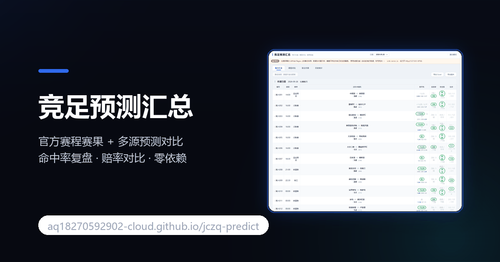

<div align="center">



# 绘梦工坊 Studio · 在线出图 / 图生视频

浏览器直连上游 API 的文生图 + 图生视频工具，附桌面客户端、完整逆向报告、59 个模型目录和 89 个探测脚本。

[](https://aq18270592902-cloud.github.io/huimeng-studio/)
[](https://github.com/aq18270592902-cloud/huimeng-studio/releases)
[](./LICENSE)
[](./index.html)
[](https://github.com/aq18270592902-cloud/huimeng-studio/stargazers)
[](https://github.com/aq18270592902-cloud/huimeng-studio/commits/main)

**[在线直接用](https://aq18270592902-cloud.github.io/huimeng-studio/)** ·
**[桌面版下载](https://github.com/aq18270592902-cloud/huimeng-studio/releases)** ·
**[逆向报告](./docs/report.md)** ·
**[模型表](./docs/prod_models.json)**

</div>

---

## 三十秒上手

打开 <https://aq18270592902-cloud.github.io/huimeng-studio/> → 写画面描述 → 选模型 → 点「开始生成」→ 等 40~80 秒 → 产物出现在右侧，可下载原文件。

不用装东西、不用后端。整个页面就一个 `index.html`，浏览器直接向上游发请求。

第一次打开先点右上角「Token 未配置」填入自己的 token（只存本机），之后一直有效。

---

## 能做什么

| 能力 | 模型 | 说明 |
|---|---|---|
| 文生图 | `z-image-turbo` | 最快，日常够用，≈1.7 积分/张 |
| 文生图 | `seedream-4-5` | 写实细腻，人像强，≈4.25 积分/张 |
| 文生图 | `nanobana-2-1` | 创意风格化，≈4 积分/张 |
| 文生图 | `mj-8-2` | Midjourney 风格，艺术氛围，≈5 积分/张 |
| 图生视频 | `seedance-2-0-mini` | 4~15 秒，480p/720p，最省 |
| 图生视频 | `seedance-2-0-fast` | 同参数，出片更快 |

图生视频需要先给一张首帧图片 URL。

---

## 界面预览

<table>
<tr>
<td width="60%" align="center">
<br>
<sub><b>文生图</b> · 左栏参数 + 右栏产物，40~80 秒出图</sub>
</td>
<td width="40%" align="center">
<br>
<sub><b>图生视频</b> · 首帧 URL + 时长 / 分辨率</sub>
</td>
</tr>
<tr>
<td width="50%" align="center">
<br>
<sub><b>v11 部署版</b> · 1000×700，早期布局存档</sub>
</td>
<td width="50%" align="center">
<br>
<sub><b>v13 修正版</b> · 1000×720，修正后布局</sub>
</td>
</tr>
</table>

> 桌面版（WinForms）实拍，网页版布局一致。Token 走本机 `localStorage` / `cfg.ini`，界面与源码里都不内置。

---

## 仓库结构

```
huimeng-studio/
├── index.html              网页版 Studio（单文件，GitHub Pages 入口）
├── site.webmanifest        PWA 清单
├── sw.js                   离线缓存（可选注册）
├── 404.html                自定义错误页
├── assets/                 og.png 分享图 + 4 尺寸图标 + 4 张 UI 截图（WebP 无损，380KB → 211KB）
├── tools/                  gen.mjs / gen_video.mjs / DreamVideo.cs / *.exe / *.bat（cfg.ini 本地放 token，不入库）
├── docs/                   report.md / prod_models.json / endpoints.txt / free_creations.md
├── demo/                   实测样例：5 张出图（长边 1376~1600px JPEG，合计 622KB）
│                          4 段视频（共 11MB）已移到 Release 附件，见下方「视频样例」
└── probe/                  89 个探测脚本（登录 / SSO / 验证码 / 上传 / 限流）
                            口令统一走 PROBE_PWD 环境变量，仓库里不留明文
```

### 视频样例（Release 附件）

仓库体积控制，4 段实测视频放在 [v1.0.0 Release](https://github.com/aq18270592902-cloud/huimeng-studio/releases/tag/v1.0.0) 的附件里，不占仓库克隆体积：

| 文件 | 规格 | 体积 | 直链 |
|---|---|---|---|
| video_10s.mp4 | 1280×720 / 24fps / 10.0s | 5.68MB | [下载](https://github.com/aq18270592902-cloud/huimeng-studio/releases/download/v1.0.0/video_10s.mp4) |
| video_test_720p.mp4 | 1280×720 / 24fps / 4.0s | 2.40MB | [下载](https://github.com/aq18270592902-cloud/huimeng-studio/releases/download/v1.0.0/video_test_720p.mp4) |
| video_test_480p.mp4 | 864×496 / 24fps / 4.0s | 1.25MB | [下载](https://github.com/aq18270592902-cloud/huimeng-studio/releases/download/v1.0.0/video_test_480p.mp4) |
| out_from_upload.mp4 | 864×496 / 24fps / 5.0s | 1.14MB | [下载](https://github.com/aq18270592902-cloud/huimeng-studio/releases/download/v1.0.0/out_from_upload.mp4) |

---

## 网页版怎么接上游

三件套请求头：

```
authorization:  Bearer <token>
x-tenant-id:    <TENANT_ID>
x-tenant-code:  <TENANT_CODE>
```

文生图：

```http
POST https://api.dimnx.com/api/aigc/text-to-image/{model}
Content-Type: application/json

{
  "taskType": "TEXT_TO_IMAGE_Z_IMAGE_TURBO",
  "entityType": "character",
  "entityId": "910141757437563478",
  "count": 1,
  "config": { "prompt": "一只橘猫", "aspectRatio": "16:9" }
}
```

图生视频：

```http
POST https://api.dimnx.com/api/aigc/image-to-video/{model}

{
  "taskType": "IMAGE_TO_VIDEO_SEEDANCE_2_0_MINI",
  "entityType": "storyboard",
  "entityId": "910141757995405936",
  "count": 1,
  "config": { "prompt": "...", "duration": 10, "resolution": "720p", "firstImage": "https://..." }
}
```

提交返回 `{"data":["<taskId>"]}`，然后轮询 `GET /api/tasks/{id}`：

```
output_data.result_response.result.image_url       // 单图
output_data.result_response.result.image_urls[0]   // 多图
output_data.result_response.result.video_url       // 视频
```

**CORS**：上游对任意 Origin 回显 `Access-Control-Allow-Origin`，预检 200 —— 所以纯静态页能直连，不需要自建代理。这是整个项目能做成单文件的前提。

---

## 已知的上游怪癖（重要）

**任务最终返回 `FAILED`，但图片其实已经生成了。**

```
状态: FAILED | 结果处理链执行失败
```

此时 `output_data.result_response.result.image_url` 已经可以取到，文件 2~5MB、magic 正确、尺寸正常，**积分也不扣**。网页版已经处理了这个情况：看到 FAILED 会继续读产物，不要重跑。

---

## 配置自己的 token

网页版**不内置任何 token**。打开页面后点右上角「Token 未配置」，粘贴自己的即可（只存本机 localStorage，源码里查不到）。

拿到 token：登录 <https://huimengi.com> → F12 → Application → Local Storage，取业务 token（JWT 字符串）。同一个弹窗里还要填 `x-tenant-id` 与 `x-tenant-code`，见 `docs/endpoints.txt`。

命令行三种给法（`tools/gen.mjs` 同样不内置任何凭据）：

```bash
# A. 参数
node tools/gen.mjs "一只橘猫" --token <jwt> --tid <tenantId> --tcode <tenantCode>

# B. 环境变量
set HM_TOKEN=<jwt>            # PowerShell: $env:HM_TOKEN="<jwt>"
set HM_TENANT_ID=<tenantId>
set HM_TENANT_CODE=<tenantCode>

# C. 同目录 cfg.ini（已被 .gitignore 忽略）
# token=<jwt>
# tenant_id=<tenantId>
# tenant_code=<tenantCode>
```

缺任一凭据时脚本直接 `exit 3` 并打印上面三种给法，不会带着空 token 去请求。

> 早前版本曾在 `index.html` 里硬编码一个长期有效的测试 token，已移除。仓库历史里仍能翻到旧 commit —— 那个 token 若还有效，属于上游未回收，与本仓库现状无关。

---

## 桌面版

`tools/DreamVideo.exe`（75KB，需 .NET Framework 4.x，Win10/11 自带）双击即用，token 存在同目录 `cfg.ini`。

从源码重编译：

```bat
C:\Windows\Microsoft.NET\Framework64\v4.0.30319\csc.exe /target:winexe /out:DreamVideo.exe DreamVideo.cs
```

---

## 本地预览

```bash
python -m http.server 8000
# 打开 http://127.0.0.1:8000/
```

不要用 `file://` 直接双击 `index.html` —— 上游的 CORS 预检在 `null` Origin 下会被拒。

---

## 排障

| 现象 | 原因 | 处理 |
|---|---|---|
| 打开页面提示「离线」 | `/billing/points` 请求失败，token 过期或被风控 | 换自己的 token；或忽略（不影响出图） |
| 提交后一直轮询不结束 | 上游排队，通常 40~80 秒，长尾可到 6 分钟 | 等，别重复提交（会重复扣积分） |
| 状态 `FAILED` 但没图 | 真失败，不是那个「误报」怪癖 | 换模型或改 prompt 重试 |
| 图生视频报 `missing first image` | 首帧 URL 为空 | 先上传一张图拿到直链，再填进去 |
| 控制台报 CORS | 用了 `file://` 打开 | 起本地 HTTP 服务 |
| 生成按钮一直灰 | 上一次任务还在跑（`busy` 锁） | 等它结束，或刷新页面 |
| 点生成弹「Token 未配置」 | 本机没有存 token | 点右上角填入；换浏览器/无痕模式需重填 |

---

## 目录之外的资料

- [`docs/report.md`](./docs/report.md) —— 完整逆向报告：鉴权、签名、OSS 上传、计费、风控
- [`docs/prod_models.json`](./docs/prod_models.json) —— 59 个模型的参数 schema 与计价表
- [`probe/`](https://github.com/aq18270592902-cloud/huimeng-studio/tree/main/probe) —— 89 个实测脚本，从匿名面探测到验证码绕过
  - 跑之前先 `export PROBE_PWD='测试口令'`，脚本从 `probe/lib_pwd.mjs` 读；不设就 exit 2，不会用任何内置口令

---

## 一句话

浏览器打开就能出图，不用装、不用注册；桌面版和命令行版在同目录，接口和模型表都在 `docs/`。
